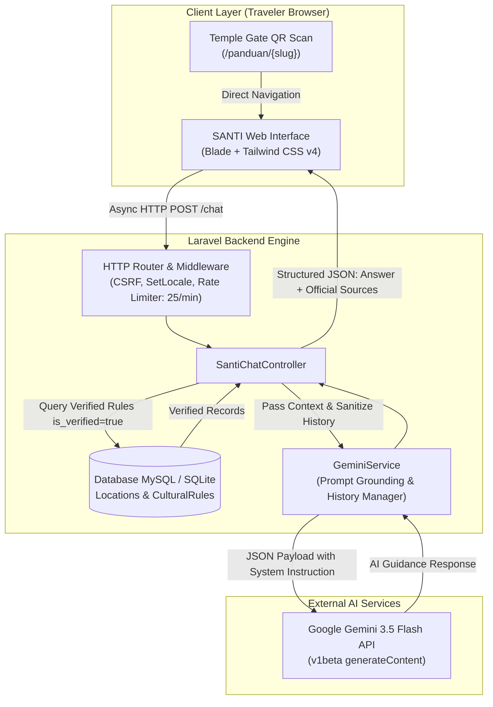

# SANTI — AI Cultural Guardian Bali
> **"Discover Bali. Respect Its Culture."**  
> *An AI-Powered Virtual Cultural Guardian & Sacred Heritage Navigator for Domestic and International Travelers in Bali.*

[](https://balidigifest.baliprov.go.id)
[](https://laravel.com)
[](https://php.net)
[](https://tailwindcss.com)
[](https://ai.google.dev)
[-21845B?style=for-the-badge)](tests/Feature/SantiCulturalGuardianTest.php)

---

## 1. Description

**SANTI (Interactive Tradition & Systems Assistant / *Sistem Asisten & Navigasi Tradisi Interaktif*)** is an innovative AI-driven cultural tourism web platform built as a digital cultural guardian (*Cultural Guardian*) for the Island of the Gods. SANTI bridges the communication and cultural etiquette gap between travelers (both domestic and global) and sacred Balinese traditions (*Dresta Bali*).

SANTI provides real-time, context-aware, respectful, and actionable cultural etiquette guidance before and during visits to sacred temples (*pura*), customary heritage villages (*desa adat*), beaches, UNESCO cultural subak rice landscapes, and sacred mountains across Bali. The platform features an **Anti-Hallucination Grounded AI Architecture** verified against official regulatory mandates, specifically Bali Governor Circular Letter No. 04/2023 (*Surat Edaran Gubernur Bali No. 4/2023*) and guidelines from Parisada Hindu Dharma Indonesia (PHDI).

---

## 2. Problem & Target User

### Problem Statement
1. **Recurring Cultural Norm Infringements**: Widespread incidents of tourists wearing improper attire in sacred temples, climbing sacred shrines (*pelinggih*), flying drones unpermitted during religious ceremonies, or trespassing into sanctified zones during spiritual impurity or mourning periods (*cuntaka/sebel*).
2. **Static & Monolingual On-Site Signage**: Traditional acrylic signs at temple gates are passive, static, and unable to interactively answer dynamic tourist questions in their native languages.
3. **Severe Cultural Hallucination Risks in Generic LLMs**: Unconstrained commercial LLMs frequently fabricate Balinese customary rules, producing inaccurate or offensive cultural advice.

### Target Users
- **Domestic Tourists (Wisatawan Nusantara)**: Seeking practical guidance on modest customary attire (*kamen & senteng*), the spiritual significance of daily offerings (*canang sari*), and photography etiquette.
- **International Travelers**: Visitors from Australia, Europe, the Americas, and Asia who require instant guidance in their primary language (English, Chinese, Japanese, Russian, French, German).
- **Cultural Heritage Custodians & Customary Village Councils (*Prajuru Adat*)**: Community guardians seeking a frictionless, automated self-education touchpoint at sanctuary entry gates via printed QR codes.

---

## 3. Key Features

1. **AI Cultural Guardian Chatbot (Multi-Turn Conversational AI)**:
   - Embodies genuine Balinese warmth and hospitality (*Ramah Tamah Bali*) starting with "Om Swastiastu", powered by **Google Gemini 3.5 Flash**.
   - Context-aware multi-turn conversational memory supporting up to 20 dialogue interactions with automated context summarization without truncating user-facing responses.
2. **Anti-Hallucination Database-Backed Grounding**:
   - Every AI response is grounded strictly in verified database rules (`cultural_rules` where `is_verified = true`).
   - If an unverified shrine is queried, SANTI transparently returns an `insufficient_verified_information` status, refusing to fabricate sacred rules and advising consultation with local temple custodians (*prajuru adat*).
3. **Comprehensive Multi-Destination Coverage (13 Sacred Locations)**:
   - Dedicated coverage including Pura Agung Besakih (Mother Temple), Pura Luhur Uluwatu, Pura Tirta Empul, Pura Ulun Danu Beratan, Pura Tanah Lot, Desa Adat Penglipuran, Subak Jatiluwih, Pantai Kuta, GWK Cultural Park, Ubud Monkey Forest, Mount Batur Kintamani, and a comprehensive *All-Bali General Scope*.
4. **Native Support for 7 International Languages**:
   - Full localization across Bahasa Indonesia (ID), English (EN), Chinese (ZH), Japanese (JA), Russian (RU), French (FR), and German (DE).
5. **Harmonious 2x2 Responsive Guidelines Grid**:
   - Clean, structured card layout categorizing rules into Dress Code (*Busana Adat*), Sacred Sanctum (*Zona Sakral*), Demeanor & Conduct (*Tata Krama*), Photography Etiquette, and General Regulations.
6. **QR-Code Scan Ready Architecture**:
   - Permanent slug-based URLs (`/panduan/pura-besakih`, `/santi/desa-penglipuran`) designed for zero-install instant access via physical QR signage at temple gates.
7. **Premium Modern Minimalist Footer & Legal Modals**:
   - Horizontal philosophical strip highlighting **Tri Hita Karana** (Parahyangan, Pawongan, Palemahan), emergency contact shortcuts (Bali Emergency 112 & Bali Tourism Police), and working regulatory policy modals for SE Gubernur Bali No. 4/2023.

---

## 4. Tech Stack

| Layer | Technology | Role & Purpose |
|---|---|---|
| **Backend Framework** | Laravel 13.x (PHP 8.4+) | Robust MVC architecture, Eloquent ORM, Rate Limiting, Strict Validation |
| **Frontend UI** | Laravel Blade + Tailwind CSS v4 | Semantic HTML, fluid typography, dark/light theme support, responsive 2x2 grid |
| **Asset Pipeline** | Vite 8.x | High-speed asset bundling, automated font fallbacks, sub-second HMR |
| **AI Engine** | Google Gemini API (`gemini-3.5-flash`) | Context grounding, latency optimization (< 4s), zero-thinking budget |
| **Database** | MySQL 8.0+ / SQLite 3 | Relational schema with migrations, factories, and deterministic seeders |
| **Testing** | PHPUnit 12.x | 20 Automated Feature & Unit Tests with `Http::fake()` mocking |
| **Security** | Laravel Middleware | CSRF Protection, Encrypted Session Cookies, Rate Limiting (`throttle:25,1`) |

---

## 5. AI Implementation

The AI integration is encapsulated within [`app/Services/GeminiService.php`](app/Services/GeminiService.php) with the following technical implementation:

- **Model Configuration**: Utilizes Google's latest `gemini-3.5-flash` model through the Google AI Studio `v1beta` REST endpoint.
- **Latency Optimization**: Explicitly configured with `thinkingBudget: 0` and a 35-second connection timeout, reducing multi-turn round-trip latency from >25s to an agile **~3.2 – 3.8 seconds**.
- **Context Injection & Cultural Grounding**:
  - Dynamically injects verified records from the `cultural_rules` table into the `systemInstruction` payload.
  - Instructs the model to explain the sacred rationale (*Tri Hita Karana & Dresta Bali*) and provide respectful, actionable alternatives (e.g., how to rent and tie a *kamen* & *senteng* properly).
- **Conversational Memory & Turn Alternation**:
  - Bounded conversational history window retaining the most recent 6 messages (3 conversational turns).
  - Contextual summarization for older messages outside the active window, preserving dialogue continuity.
  - Model responses in history exceeding 800 characters are condensed for API token payload efficiency without affecting the full text rendered in the user's interface.
  - Strictly enforces alternating role requirements (`user` &rarr; `model` &rarr; `user`) compliant with Gemini API specifications.
- **Resilient Fallback Handlers**:
  - Catches connection timeouts and HTTP 429 rate-limiting gracefully, returning localized fallback messages paired with official verified database rules.

---

## 6. Architecture / Data Flow



---

## 7. Installation / Run Instructions

Follow these steps to set up and run SANTI in your local development environment:

### Prerequisites
- **PHP**: >= 8.3 (with `pdo_mysql`, `curl`, `mbstring`, `openssl`, `intl` extensions enabled)
- **Composer**: >= 2.5
- **Node.js & npm**: Node.js >= 20.x, npm >= 10.x
- **Database**: MySQL 8.0+ or MariaDB 10.4+ (or SQLite)

### Step 1: Clone Repository & Enter Directory
```bash
git clone https://github.com/justsanzz07/lomba-bali-.git
cd lomba-bali-
```

### Step 2: Install PHP & Node.js Dependencies
```bash
composer install
npm install
```

### Step 3: Configure Environment File
```bash
cp .env.example .env
php artisan key:generate
```

### Step 4: Configure Database & API Key in `.env`
Update your `.env` file with your database credentials and Gemini API key:
```env
DB_CONNECTION=mysql
DB_HOST=127.0.0.1
DB_PORT=3306
DB_DATABASE=santi_bali
DB_USERNAME=root
DB_PASSWORD=

# Obtain a free API key at https://aistudio.google.com
GEMINI_API_KEY=your_gemini_api_key_here
GEMINI_MODEL=gemini-3.5-flash
```

### Step 5: Run Database Migrations & Seeders
```bash
php artisan migrate:fresh --seed
```

### Step 6: Compile Frontend Assets
```bash
npm run build
```

### Step 7: Launch Local Development Server
```bash
php artisan serve
```
Access the application in your browser at: **`http://127.0.0.1:8000`**

---

## 8. Deployment URL

- **Official GitHub Repository**: [https://github.com/justsanzz07/lomba-bali-](https://github.com/justsanzz07/lomba-bali-)
- **Live Deployment URL**: [https://santi-ai-topaz.vercel.app](https://santi-ai-topaz.vercel.app)  
  *(Production Serverless Mirror with Seeded Cultural Heritage Database)*
- **Local Development URL**: `http://127.0.0.1:8000`

---

## 9. Demo Account

SANTI is architected as an open **Public Citizen & Tourist Service Platform** that prioritizes immediate accessibility (*Guest-Accessible by Design*). Travelers scanning QR codes at temple gates require zero account registration or credential entry. Abuse is mitigated through server-side IP rate limiting (`throttle:25,1`).

---

## 10. Known Limitations

1. **Gemini API Free-Tier Rate Limits**: Free tier keys from Google AI Studio operate with per-minute rate limits (RPM). If exhausted during peak concurrent queries, the system gracefully falls back to displaying verified database guidelines.
2. **Remote Mountain Connectivity**: AI inference requires an active internet connection. Offline progressive caching (*PWA Service Worker*) for essential rule checklists is earmarked for future releases.
3. **Customary Adat Rule Curation Scope**: The current verified dataset comprehensively covers 13 flagship cultural landmarks in Bali. Expanding to all 1,493 customary villages across Bali requires ongoing partnership with local village councils (*desa adat*).

---

## 11. Third-party Resources / Credits

- **Regulatory Framework & Cultural Directives**:
  - *Bali Governor Circular Letter No. 04 of 2023* concerning New Order Standards for Foreign Tourists Visiting Bali.
  - *Sacred Sanctuary Guidelines* — Parisada Hindu Dharma Indonesia (PHDI) Bali.
  - *Pura Agung Besakih Management Etiquette & Customary Decrees*.
- **Visual Assets & Typography**:
  - Plus Jakarta Sans Typography (Google Fonts / Tokotype).
  - Unsplash Photography (Cultural documentation photography of Bali).
  - Heroicons (Tailwind Labs).
- **Frameworks & Infrastructure**:
  - Laravel Framework (Taylor Otwell & Laravel Open Source Contributors).
  - Google Gemini AI (Google DeepMind).

---

## 12. Team Members

**SANTI Development Team (Bali DigiFest 2026 AI Web Innovation Challenge)**:

| No | Full Name | Role & Responsibility | Affiliation |
|:---:|---|---|---|
| **1** | **Nur Hasan** | Full-Stack Developer & AI Systems Engineer | Balinese Digital Innovation Team |
| **2** | **SANTI Cultural Tech Team** | UX Designer & Balinese Cultural Heritage Researcher | Balinese Digital Innovation Team |

---
*Matur Suksma. Rahayu Sareng Sami.* 🙏🌺
